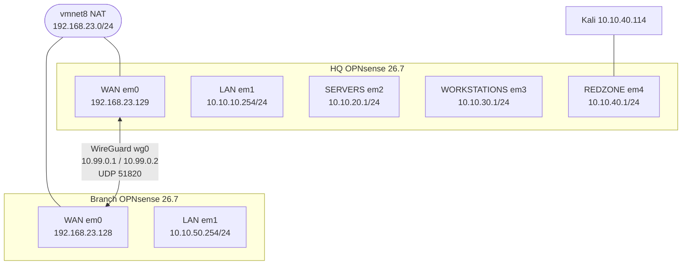

# Mjolnir VLAN Segmentation and WireGuard Site-to-Site Lab

A segmented home lab built on two OPNsense 26.7 firewalls running as VMs under VMware Workstation. The HQ firewall splits the lab into four internal zones, and a second "Branch" firewall is joined to it over an encrypted WireGuard tunnel. The tunnel rules are scoped to specific subnets rather than left open, and the result is tested and documented with screenshots.

## Topology

## What is in this repo

| Path | Contents |
|---|---|
| [docs/architecture.md](docs/architecture.md) | Zones, subnets, VMware networks, host environment |
| [docs/segmentation.md](docs/segmentation.md) | Zone firewall policy and a design observation about the catch-all rule |
| [docs/wireguard-site-to-site.md](docs/wireguard-site-to-site.md) | Tunnel design and the exact configuration on both firewalls |
| [docs/verification.md](docs/verification.md) | Tests run, results, and screenshot evidence |
| [docs/troubleshooting.md](docs/troubleshooting.md) | Problems hit during the build, how each was diagnosed and fixed |
| [evidence/](evidence/) | Numbered screenshots referenced by the docs |

## Results at a glance

| Test | Result | Evidence |
|---|---|---|
| WireGuard handshake on both peers | Established, traffic counters increasing | [05](evidence/05-wireguard-status-handshakes.png) |
| Branch to HQ tunnel address (`10.99.0.1`) | 3/3 replies | [12](evidence/12-tunnel-ping-branch-to-hq.png) |
| HQ to Branch tunnel address (`10.99.0.2`) | 3/3 replies | [13](evidence/13-tunnel-ping-hq-to-branch.png) |
| Kali in REDZONE to Branch LAN (`10.10.50.254`) | 3/3 replies across the tunnel | [14](evidence/14-kali-cross-tunnel-ping.png) |
| Branch LAN source to HQ LAN (`10.10.10.254`) | 50/50 replies | [15](evidence/15-branch-lan-allowed-and-blocked-tests.png) |
| Branch LAN source to HQ SERVERS (`10.10.20.1`) | No replies, blocked and logged on HQ `wg0` | [15](evidence/15-branch-lan-allowed-and-blocked-tests.png), [16](evidence/16-hq-log-blocked-wg0.png) |

## Environment

| Item | Value |
|---|---|
| Host | EndeavourOS (Arch-based) |
| Hypervisor | VMware Workstation Pro 26H1 |
| Firewalls | OPNsense 26.7 (HQ and Branch) |
| Test VM | Kali Linux in REDZONE |

## Limitations and open items

- **The Branch has no client VMs.** Its LAN tests use OPNsense's own ping tool with the source address set to the Branch LAN address, so they exercise the firewall rules rather than a real host on that LAN.
- **The REDZONE catch-all allows more than internet access.** Kali can reach the Branch LAN because only the HQ zones are blocked ahead of the catch-all. See [segmentation.md](docs/segmentation.md).
- **Host adapter IP on vmnet5** was removed with a command that does not survive a reboot. The permanent fix and a possible repeat on other vmnets are in [troubleshooting.md](docs/troubleshooting.md).
- **Cosmetic:** the Branch still uses the default hostname `OPNsense.internal`.
- **Full rule exports are not included.** OPNsense config exports contain keys and password hashes, so they are excluded on purpose.
