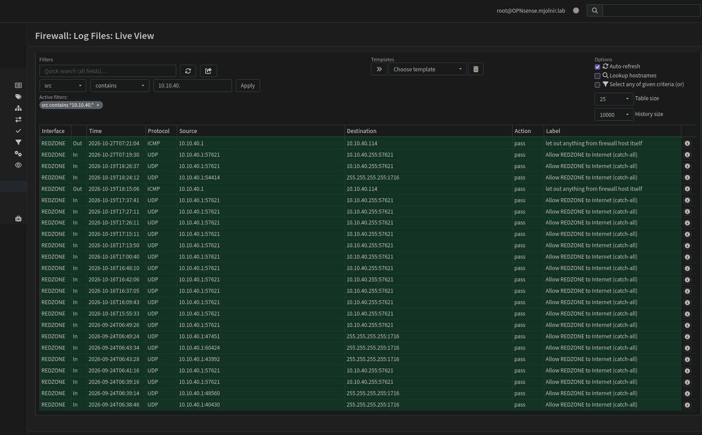
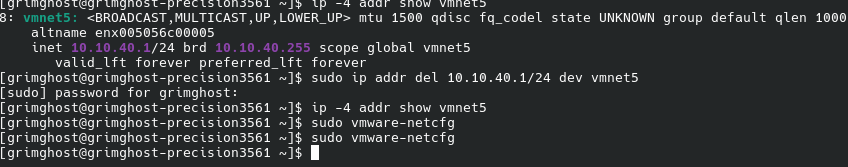

# Troubleshooting log

Each entry gives the symptom, how it was diagnosed, and the fix.

## 1. vmnet2 refused to start after the subnet drifted

**Symptom.** The host could not reach the HQ firewall GUI on `10.10.10.254`.

**Diagnosis.**
- `ip addr show vmnet2` showed the host adapter on `10.10.11.1/24` instead of `10.10.10.0/24`. The cause of the drift was not determined.
- After the subnet was edited, `vmnet2` disappeared and `systemctl restart vmware-networks` failed.
- `lsof /dev/vmnet2` returned nothing, so nothing was holding the device open.
- The service log gave the reason:

```
vmware-networks: Subnet on vmnet2 is no longer available for usage,
please run the network editor to reconfigure different subnet
```

**Fix.** In `sudo vmware-netcfg`, set vmnet2 to subnet `10.10.10.0`, mask `255.255.255.0`, with local DHCP off. Then `sudo systemctl restart vmware-networks`. `ip addr show vmnet2` then showed `10.10.10.1/24`. A plain `ip addr add` would not have fixed it, because the wrong subnet was stored in VMware's own configuration.

## 2. "Destination Host Unreachable" from the host

**Symptom.** After the vmnet2 fix, the host's pings to both firewalls returned "Destination Host Unreachable".

**Diagnosis.** The two firewall VMs were powered off, so nothing answered ARP.

**Fix.** Power the VMs on. Both then replied. Check VM power state before debugging firewall rules.

## 3. Duplicate gateway address on vmnet5

**Symptom.** Kali (10.10.40.114) could not ping the Branch LAN across the tunnel, although the tunnel itself was up.

**Diagnosis.**
1. Routing was correct on both firewalls ([HQ](../evidence/06-hq-routes.png), [Branch](../evidence/07-branch-routes.png)).
2. HQ's live log, filtered by source `10.10.40.`, showed only entries from `10.10.40.1` and none from Kali. Kali's traffic was not reaching the firewall.
   
3. The host's own vmnet5 adapter held `10.10.40.1/24`, the same address as HQ's REDZONE interface.
   
4. On Kali, `ip neigh show 10.10.40.1` reported `FAILED`, so Kali could not resolve its gateway.

**Fix.** On the host: `sudo ip addr del 10.10.40.1/24 dev vmnet5`. On Kali: `sudo ip neigh flush all`. The ping then succeeded ([evidence](../evidence/14-kali-cross-tunnel-ping.png)).

**Still open.**
- The `ip addr del` does not survive a host reboot. The permanent fix is to untick "Connect a host virtual adapter to this network" for vmnet5 in `sudo vmware-netcfg`. That change has not been confirmed in this repo.
- vmnet3 and vmnet4 were not checked, and they could have the same collision with `10.10.20.1` and `10.10.30.1`.

## 4. Unscoped rules cancelled the scoped tunnel rules

**Symptom.** The scoped WireGuard group rules existed but restricted nothing.

**Diagnosis.** Each firewall still had three leftover any-to-any rows above the scoped rules ([HQ](../evidence/08-wg-rules-before-hq.png), [Branch](../evidence/09-wg-rules-before-branch.png)). OPNsense applies the first matching rule, so the scoped rules were never reached. The green play icons in the rule list are indicators, not buttons.

**Fix.** Select the rows, disable them from the toolbar under the table, apply, retest, then delete them. Final state: [HQ](../evidence/10-wg-rules-after-hq.png), [Branch](../evidence/11-wg-rules-after-branch.png).

## 5. Not root-caused: one failed tunnel ping after the lockdown

After the rules were cleaned up, one ping from the Branch console to `10.99.0.1` returned 100% loss. A later retest passed ([evidence](../evidence/12-tunnel-ping-branch-to-hq.png)). The cause was not isolated. Unapplied rule changes are a suspicion only, and no log was captured to confirm it.

## Notes

- Pinging a firewall's own tunnel address from its own console proves nothing, because the replies come from the local interface. Sub-millisecond times are the giveaway. Each firewall must ping the other's address.
