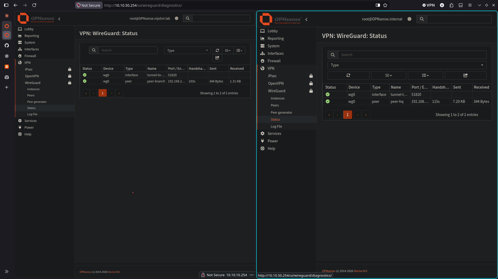
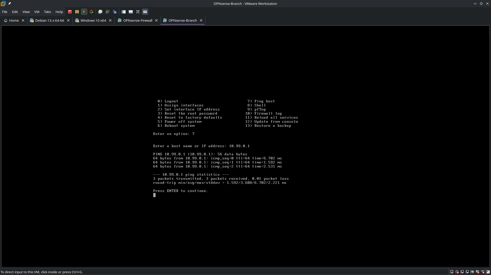
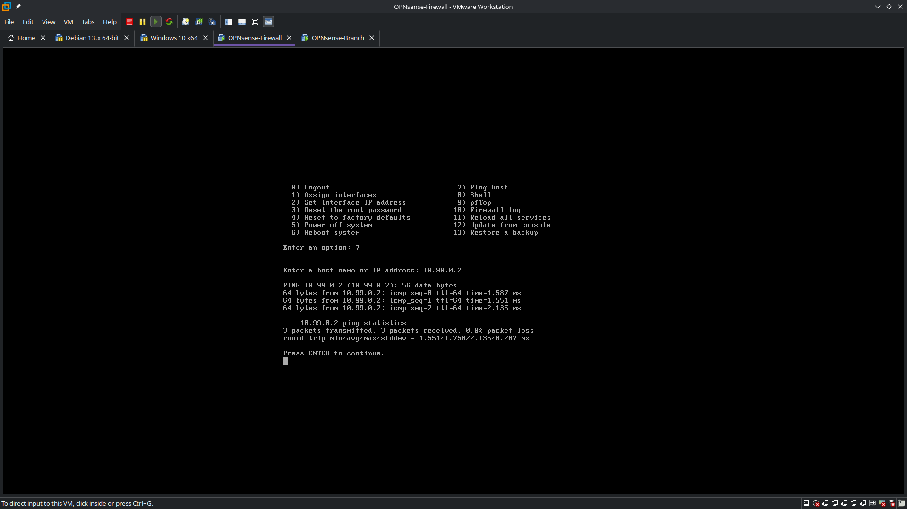
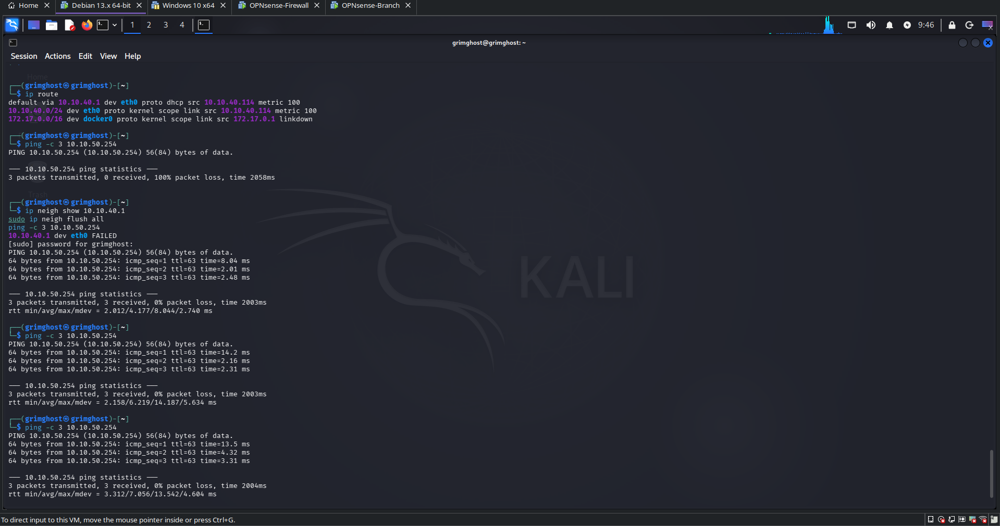
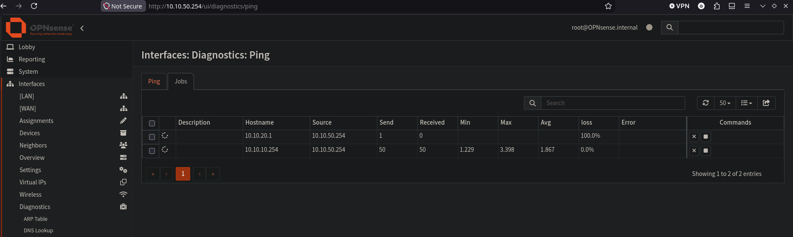
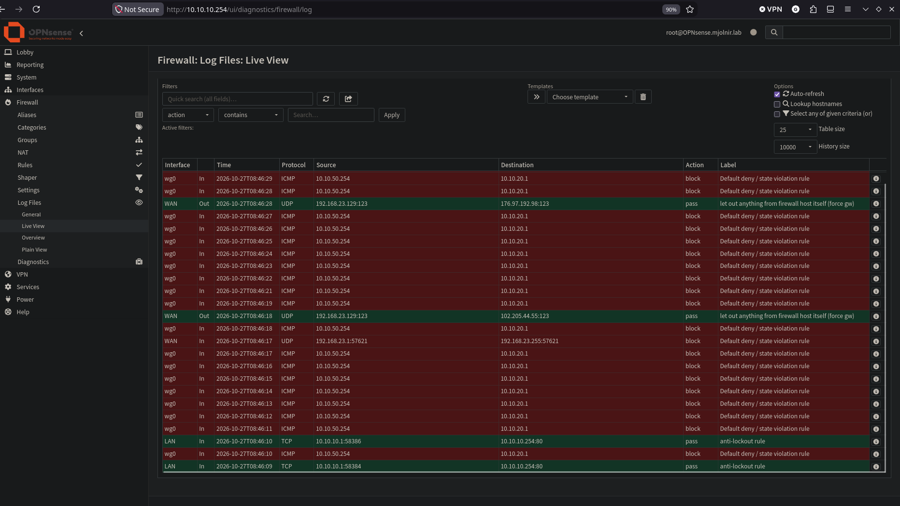

# Verification

All results below come from the screenshots in `evidence/`. Latency figures are as displayed on the console or terminal.

## 1. Tunnel is up

Both peers show a recent handshake and data transferred in each direction.

## 2. Tunnel addresses reach each other

Run from each firewall's console (option 7, Ping host), after the rules in [wireguard-site-to-site.md](wireguard-site-to-site.md) were in their final state.

| From | To | Result |
|---|---|---|
| Branch | 10.99.0.1 | 3/3 received, 0.0% loss, avg 3.608 ms |
| HQ | 10.99.0.2 | 3/3 received, 0.0% loss, avg 1.758 ms |

## 3. A host behind HQ reaches the Branch LAN

Kali (10.10.40.114, REDZONE) pings the Branch LAN address through the tunnel. TTL 63 is consistent with a single routed hop at HQ. The terminal also shows the earlier failed attempt and the fix, see [troubleshooting.md](troubleshooting.md).

## 4. The lockdown allows what it should and blocks the rest

The Branch has no client VM, so these tests use Interfaces > Diagnostics > Ping on the Branch with the **source address set to the Branch LAN address (10.10.50.254)**. The default source would be the tunnel address, which none of the scoped rules match.

| Source | Destination | Expected | Result |
|---|---|---|---|
| 10.10.50.254 | 10.10.10.254 (HQ LAN) | Allowed | 50 sent, 50 received, 0.0% loss, avg 1.867 ms |
| 10.10.50.254 | 10.10.20.1 (HQ SERVERS) | Blocked | No replies |

On HQ, each attempt to `10.10.20.1` appears in the live log as a block on `wg0`, labelled "Default deny / state violation rule".

The 10.10.20.1 job in the screenshot was still running when captured and shows 1 packet sent. The log shows the repeated blocked attempts.

## 5. Scope of these tests

- Tests 2 and 3 show the tunnel carries traffic. Test 4 shows the scoped rules block a destination that is not listed.
- Not tested: every other zone pair, UDP or TCP application traffic over the tunnel, and tunnel recovery after a host reboot.
